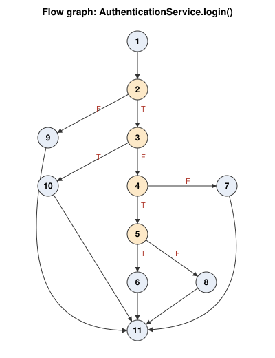
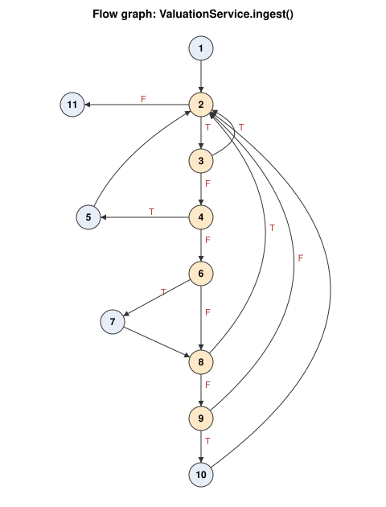

| Work product | Author(s) |
|---|---|
| Black-box test design and `CpfGrantServiceBlackBoxTest` | Roen, Aleesha, Manwen, Jing Yi, Junyao |
| Basis path test design and the two `*BasisPathTest` classes | Roen, Aleesha, Manwen, Jing Yi, Junyao |
| Test execution and this report | Roen, Aleesha, Manwen, Jing Yi, Junyao |

## 1. Scope and how to run

| Lab 4 item | What we tested | Technique | Test class |
|---|---|---|---|
| 3.2.1 | Control class `CpfGrantService` (UC-06, UC-07; FR-10 to FR-13) | Equivalence classes + boundary values | `service/CpfGrantServiceBlackBoxTest` |
| 3.2.2 (method 1) | `AuthenticationService.login()` (UC-11; FR-26) | Basis path | `service/AuthenticationServiceBasisPathTest` |
| 3.2.2 (method 2) | `ValuationService.ingest()` (UC-12; FR-29, FR-30) | Basis path | `service/ValuationIngestBasisPathTest` |

All tests are automated with JUnit 5, AssertJ and Mockito (Spring Boot test starter). Run them from `backend/`:

```bash
mvn test                                                     # whole suite (68 tests)
mvn test -Dtest='CpfGrantServiceBlackBoxTest,*BasisPathTest' # only the Lab 4 tests (42 tests)
```

**Result of the run on 27 Oct 2026:** 68 tests, 0 failures, 0 errors (42 of them are the Lab 4 tests below).

## 2. Black-box testing of `CpfGrantService`

### 2.1 Why this class

`CpfGrantService` is the control class behind UC-06 *Calculate CPF Grant Eligibility* and UC-07 *Submit Financial
Profile*. It turns a buyer's income, marital status and parents' location into CPF Housing Grant, EHG and PHG amounts, then works out the
down payment, loan, monthly instalment and an affordability rating. Getting it wrong tells a buyer they can afford a
flat they cannot, so it is the most consequential calculation in the system. It also has many input variables with
clear ranges in the SRS, which suits equivalence class and boundary value testing.

**Fixture.** One 4-room flat in Ang Mo Kio last sold for **$500,000**. Parent postal code `560123` (postal sector 56)
is about **1.1 km** away and `640123` (sector 64, Jurong) about **14.3 km** away. Grant rules are the real
`grant-rules.yml` (Family Grant S$80,000 for 2- to 4-room up to S$16,000 income, Singles Grant S$40,000 up to S$8,000; EHG ceiling $9,000; PHG within 4 km; 25 years at 2.6%, 25% minimum down payment, 30% MSR).

Expected values were worked out by hand and with a separate Python script from the SRS and `grant-rules.yml`,
not by running the code.

### 2.2 Equivalence classes

| Input (source) | Valid classes | Invalid classes |
|---|---|---|
| Monthly household income (FR-10) | V1 family: 0 to 9,000 (EHG band applies)<br>V2 family: 9,001 to 1,000,000 (no EHG)<br>V3 single: 0 to 4,500 (half EHG at 2x income)<br>V4 single: 4,501 to 1,000,000 (no EHG) | I1 below 0<br>I2 above 1,000,000<br>I3 missing |
| Income for the CPF Housing Grant (FR-11) | V21 family: up to 16,000<br>V22 family: above 16,000 (no grant)<br>(singles: up to 8,000 / above 8,000) | |
| Flat type (FR-11) | V23 2- to 4-room (larger grant)<br>V24 5-room, Executive, Multi-generation (smaller grant) | |
| Marital status (FR-10) | V5 SINGLE<br>V6 MARRIED or ENGAGED (family nucleus) | I4 missing |
| Living with parents (FR-11) | V7 yes<br>V8 no | none (boolean) |
| Parents' postal code (UC-07) | V9 blank (no PHG check)<br>V10 known sector within 4 km<br>V11 known sector beyond 4 km | I5 not 6 digits<br>I6 6 digits but unknown sector |
| Loan tenure, years (FR-13) | V12 5 to 30<br>V13 not given (default 25) | I7 below 5<br>I8 above 30 |
| Down payment % (FR-13) | V14 0 to under 25 (raised to 25 with a notice)<br>V15 25 to 100 (used as given)<br>V16 not given (default 25) | I9 below 0<br>I10 above 100 |
| Interest rate % (FR-13) | V17 0 (zero-interest formula)<br>V18 above 0 to 10<br>V19 not given (default 2.6) | I11 below 0<br>I12 above 10 |
| Flat | V20 exists | I13 unknown id |
| Affordability (output, FR-12) | O1 instalment/income at most 25% COMFORTABLE<br>O2 above 25% to 30% STRETCHED<br>O3 above 30% ABOVE_LIMIT<br>O4 income 0 UNKNOWN | |

### 2.3 Boundary values

| Boundary | Values tested | Test ids |
|---|---|---|
| EHG first band edge (family) | 1,500 / 1,501 | BB-01, BB-02 |
| EHG ceiling (family) | 9,000 / 9,001 | BB-03, BB-04 |
| EHG ceiling (single, 2x income) | 4,500 / 4,501 | BB-05, BB-06 |
| CPF Housing Grant ceiling | family 16,000 / 16,001; single 8,000 / 8,001 | BB-28 |
| Income lower limit | -1 / 0 | BB-12, BB-07 / BB-21 |
| Income upper limit | 1,000,000 / 1,000,001 | BB-21, BB-13 |
| Tenure | 4 / 5 / 30 / 31 | BB-14, BB-08, BB-09, BB-15 |
| Down payment | -0.01 / 0 / 24.99 / 25 / 100 / 100.01 | BB-16, BB-08, BB-10, BB-11, BB-09, BB-17 |
| Interest | -0.01 / 0 / 10 / 10.01 | BB-18, BB-08, BB-09, BB-19 |
| PHG distance | 4.0 km / 4.01 km | BB-26 |
| Affordability ratio | 25.0% / 25.1% / 30.0% / 30.1% | BB-27 |
| BB-28 | V21, V22, V23, V24 boundaries | Married 16,000 / 16,001 (4-room); Single 8,000 / 8,001 (4-room); Engaged 5,000 (5-room); Single 5,000 (Executive); Married 5,000 (2-room) | 80,000 / 0; 40,000 / 0; 50,000; 25,000; 80,000 | Same. Pass |

**Keeping the number of cases down.** Each valid test covers several valid classes at once (for example BB-08 covers
V12 lower edge, V14 lower edge and V17 together). Each invalid test changes exactly one input away from a valid
baseline, so a rejection can only come from that input. Boundaries were chosen at the edges where behaviour changes
in the SRS (band edges, ceilings, the 25% minimum, the 4 km rule, the MSR thresholds) rather than at arbitrary points.

### 2.4 Test cases and results

Unless stated, loan fields are left blank (defaults: 25 years, 2.6%, 25% down) and the user is not living with
parents. "Rating" is the affordability rating. All amounts in S$.

| Id | Classes | Test input | Expected output | Actual output |
|---|---|---|---|---|
| BB-01 | V1, V6, V8, V9, V13, V16, V19, V21, V23, O3 | Married, income 1,500, no postal code | Family Grant 80,000; EHG 120,000; PHG 0 ("Add your parents' postal code"); down 125,000; loan 175,000; instalment 794; ABOVE_LIMIT; defaults 25 y / 2.6% / 25% shown | Same. Pass |
| BB-02 | V1 (edge) | Married, income 1,501 | Family Grant 80,000; EHG 110,000; loan 185,000; instalment 839 | Same. Pass |
| BB-03 | V1 (edge), O1 | Married, income 9,000 | Family Grant 80,000; EHG 5,000; loan 290,000; instalment 1,316; COMFORTABLE | Same. Pass |
| BB-04 | V2 (edge), V6, V10 | Engaged, income 9,001, parents at 560123 | Family Grant 80,000; EHG 0; PHG 20,000; parent distance 1.1 km; instalment 1,248; COMFORTABLE | Same. Pass |
| BB-05 | V3 (edge), V5, V7 | Single, income 4,500, living with parents | Singles Grant 40,000; EHG 2,500; PHG 15,000; loan 317,500; instalment 1,440 | Same. Pass |
| BB-06 | V4 (edge) | Single, income 4,501 | Singles Grant 40,000; EHG 0; PHG 0; instalment 1,520 | Same. Pass |
| BB-07 | V1 (edge 0), V11, O4 | Married, income 0, parents at 640123 | Family Grant 80,000; EHG 120,000; PHG 0 ("more than 4 km"); distance 14.3 km; rating UNKNOWN | Same. Pass |
| BB-08 | V12, V14, V17 (lower edges) | Married, 9,001; tenure 5; down 0%; interest 0% | Down raised to 25% (125,000) with a notice; grants 80,000; loan 295,000; instalment 4,917 (295,000 / 60) | Same. Pass |
| BB-09 | V12, V15, V18 (upper edges) | Married, 9,001; tenure 30; down 100%; interest 10% | Down 500,000; loan 0; instalment 0; COMFORTABLE | Same. Pass |
| BB-10 | V14 (upper edge) | Married, 9,001; down 24.99% | Raised to 25% with notice; instalment 1,338 | Same. Pass |
| BB-11 | V15 (lower edge) | Married, 9,001; down 25% | 25% used, no notice; instalment 1,338 | Same. Pass |
| BB-12 | I1 | Income -1 | Rejected on `profile.householdIncome` (HTTP 422) | Same. Pass |
| BB-13 | I2 | Income 1,000,001 | Rejected on `profile.householdIncome` | Same. Pass |
| BB-14 | I7 | Tenure 4 | Rejected on `loanTenureYears` | Same. Pass |
| BB-15 | I8 | Tenure 31 | Rejected on `loanTenureYears` | Same. Pass |
| BB-16 | I9 | Down -0.01% | Rejected on `downPaymentPercent` | Same. Pass |
| BB-17 | I10 | Down 100.01% | Rejected on `downPaymentPercent` | Same. Pass |
| BB-18 | I11 | Interest -0.01% | Rejected on `interestRatePercent` | Same. Pass |
| BB-19 | I12 | Interest 10.01% | Rejected on `interestRatePercent` | Same. Pass |
| BB-20 | I5 | Postal code `12345` | Rejected on `profile.parentPostalCode` | Same. Pass |
| BB-21 | valid edges | (a) income 0, tenure 5, down 0, rate 0; (b) income 1,000,000, tenure 30, down 100, rate 10 | No validation errors | Same. Pass |
| BB-22 | I6 | Postal code `990000` | 422, field error on `parentPostalCode` (UC-07.EX.2) | Same. Pass |
| BB-23 | I4 | Marital status missing, no saved profile | 422 `PROFILE_REQUIRED` (UC-06.EX.1) | Same. Pass |
| BB-24 | I3 | Income missing, no saved profile | 422 `PROFILE_REQUIRED` | Same. Pass |
| BB-25 | I13 | Flat id 999 | 404 `NOT_FOUND` | Same. Pass |
| BB-26 | PHG boundary | Married, not with parents, distance 4.0 km / 4.01 km | 20,000 / 0 | Same. Pass |
| BB-27 | O1, O2, O3 boundaries | Income 10,000; instalment 2,500 / 2,510 / 3,000 / 3,010 | COMFORTABLE / STRETCHED / STRETCHED / ABOVE_LIMIT | Same. Pass |

BB-26 to BB-28 call `phg()`, `affordability()` and `cpfHousingGrant()` directly, because no real postal sector sits exactly 4 km from a
flat and no real loan gives an instalment of exactly 25% of income.

## 3. White-box (basis path) testing

### 3.1 Method 1: `AuthenticationService.login()`

Implements UC-11 with the lockout rule (5 failed attempts lock the account for 15 minutes, TBD-4).



| Node | Code (`AuthenticationService.java`) |
|---|---|
| 1 | Look up the user by trimmed email (lines 91 to 93) |
| 2 | **P1** user found? |
| 3 | **P2** `user.isLocked(now)` (line 94) |
| 4 | **P3** password does not match (line 97) |
| 5 | `failures = attempts + 1`; **P4** `failures >= maxFailedLogins` (lines 98, 99) |
| 6 | Reset count, lock for 15 minutes, save, throw 423 (lines 100 to 103) |
| 7 | Reset count and lock, save, start session, return token (lines 109 to 112) |
| 8 | Save the new count, throw 401 (lines 105 to 107) |
| 9 | Throw 401 `INVALID_CREDENTIALS` (line 93) |
| 10 | Throw 423 `ACCOUNT_LOCKED` (line 95) |
| 11 | Exit |

**Cyclomatic complexity.** Edges E = 14, nodes N = 11, so V(G) = E - N + 2 = **5**. Check: 4 predicate nodes + 1 = 5,
and the graph has 5 regions.

| Id | Basis path | Test input | Expected output | Actual output |
|---|---|---|---|---|
| WB-A1 | 1-2-9-11 | Email `nobody@example.com` (not registered) | 401 `INVALID_CREDENTIALS`; nothing saved | Same. Pass |
| WB-A2 | 1-2-3-10-11 | Registered user locked for 10 more minutes; correct password | 423 "locked for 10 more minutes"; password not even checked | Same. Pass |
| WB-A3 | 1-2-3-4-5-8-11 | Registered user, 0 previous failures, wrong password | 401; failed attempts now 1; not locked | Same. Pass |
| WB-A4 | 1-2-3-4-5-6-11 | Registered user, 4 previous failures, wrong password | 423 "locked for 15 more minutes"; locked until now + 15 min; count reset to 0 | Same. Pass |
| WB-A5 | 1-2-3-4-7-11 | Email with spaces around it, 3 previous failures, expired lock, correct password | Token returned; count 0; lock cleared; session saved | Same. Pass |

### 3.2 Method 2: `ValuationService.ingest()`

Part of the 24-hour batch (UC-12). It takes new resale records from data.gov.sg, skips records with no town, flags
towns with incomplete records so their baseline is not updated (UC-12.EX.2), matches each record to a known flat or
geocodes a new one, and stores transactions it has not seen before.



| Node | Code (`ValuationService.java`) |
|---|---|
| 1 | Set up result set, town map and counter (lines 198 to 201) |
| 2 | **P1** another record in the list? (line 203) |
| 3 | **P2** town missing or blank? (line 204) |
| 4 | **P3** price or area not positive, or month or flat type missing? (line 207) |
| 5 | Flag the town as incomplete (line 208) |
| 6 | Look up the flat; **P4** not found? (lines 211 to 213) |
| 7 | `createFlat()`: geocode and save a new flat (line 214) |
| 8 | **P5** still no flat? (line 216) |
| 9 | **P6** transaction not stored yet? (line 220) |
| 10 | Save transaction, update the flat's latest price, count it (lines 221 to 224) |
| 11 | Return the result (line 228) |

**Cyclomatic complexity.** E = 16, N = 11, so V(G) = 16 - 11 + 2 = **7**. Check: 6 predicate nodes + 1 = 7.

The basis set was built with the baseline method: start from the most common path (WB-B4, a new sale of a known flat),
then flip one decision at a time.

| Id | Basis path | Test input | Expected output | Actual output |
|---|---|---|---|---|
| WB-B1 | 1-2-11 | Empty list | 0 inserted; no towns flagged | Same. Pass |
| WB-B2 | 1-2-3-2-11 | One record with town `" "` | 0 inserted; no towns flagged; nothing saved | Same. Pass |
| WB-B3 | 1-2-3-4-5-2-11 | One Ang Mo Kio record with price 0 | 0 inserted; ANG MO KIO flagged incomplete | Same. Pass |
| WB-B4 | 1-2-3-4-6-8-9-10-2-11 | New sale (Sep 2026, $510,000) of a known flat last sold for $480,000 | 1 inserted; flat's latest price now 510,000 (2026-09); no geocoding call | Same. Pass |
| WB-B5 | 1-2-3-4-6-8-9-2-11 | Same sale, already stored | 0 inserted; latest price stays 480,000 | Same. Pass |
| WB-B6 | 1-2-3-4-6-7-8-9-10-2-11 | Sale of unknown block 999; geocoder returns an exact point | New flat created; 1 inserted | Same. Pass |
| WB-B7 | 1-2-3-4-6-7-8-2-11 | Sale of unknown block 999; geocoder only returns an approximate point | Skipped: 0 inserted; no flat saved | Same. Pass |

### 3.3 Evidence that the tests do their job

**Coverage (JaCoCo 0.8.12, Lab 4 tests only).** `login()`: 100% of instructions and branches.
`ingest()`: 100% of instructions and 80% of branches. The 4 branches not taken are single conditions inside the two
compound predicates (P2 has 2 conditions, P3 has 4). Basis path testing treats each compound predicate as one decision,
as in the lecture method, so this is expected. Counting every simple condition as its own node would give V(G) = 11,
which is also what JaCoCo reports.

**Fault injection.** We introduced four realistic one-character bugs and ran the Lab 4 tests against each. Every bug was
caught, then the code was restored.

| Bug introduced | Caught by |
|---|---|
| PHG: `parentKm <= 4` changed to `< 4` | BB-26 |
| Affordability: `ratio <= 25` changed to `< 25` | BB-27 |
| Lockout: `failures >= 5` changed to `> 5` (locks on the 6th try) | WB-A4 |
| Ingest: duplicate check removed | WB-B5 |

## 4. Traceability

| Requirement | Use case | Design class | Code | Test cases |
|---|---|---|---|---|
| FR-10 financial profile input | UC-07 | `CpfGrantService`, `FinancialProfileDto` | `estimate()`, `saveProfile()` | BB-12, BB-13, BB-20 to BB-24 |
| FR-11 CPF Housing Grant, EHG and PHG estimate | UC-06 | `CpfGrantService`, `GrantRules` | `cpfHousingGrant()`, `ehg()`, `phg()` | BB-01 to BB-07, BB-26, BB-28 |
| FR-12 instalment and assumptions | UC-06 | `CpfGrantService` | `estimate()`, `monthlyInstalment()`, `affordability()` | BB-01, BB-08, BB-09, BB-27 |
| FR-13 adjustable loan assumptions | UC-06 | `CpfGrantRequestDto` | Bean Validation constraints | BB-08 to BB-11, BB-14 to BB-19, BB-21 |
| FR-26 lockout after failed logins | UC-11 | `AuthenticationService` | `login()` | WB-A1 to WB-A5 |
| FR-29 ingest new transactions | UC-12 | `ValuationService`, `ExternalApiGateway` | `ingest()` | WB-B1, WB-B4 to WB-B7 |
| FR-30 / UC-12.EX.2 incomplete data | UC-12 | `ValuationService` | `ingest()` | WB-B2, WB-B3 |

## 5. Limitations

- Tests replace the database and external APIs with Mockito mocks, so they check the logic, not the SQL or the real
  government APIs. `ApiFlowTest` covers the full HTTP stack against an embedded H2 database.
- Grant amounts are tested against `grant-rules.yml`, so the file itself was checked on 27 Oct 2026. The EHG table for
  families, HDB's own EHG table for singles and the PHG amounts all match. The CPF Housing Grant (Family Grant / Singles Grant) for resale flats was missing, so it was added on 27 Oct 2026 (BB-01 to BB-11 and BB-28 cover it). SRS v1.4 (in `docs/requirements/`) is the version these tests trace to; its FR-11 names this grant.
- **Finding (resolved): loan limits on screen vs API.** The CPF panel's sliders now allow tenure 5 to 25 years,
  down payment 25% to 100% and interest 0% to 10%. Tenure stops at 25 years because that is the HDB loan maximum
  (bank loans go to 30). Down payment starts at 25% because an HDB loan covers at most 75% of the price; the API
  still accepts lower values and raises them to 25% with a notice (BB-08, BB-10). The API's 30-year tenure limit
  is kept; lowering `@Max(30)` to 25 would also require updating BB-09, BB-15 and BB-21.
  **Limitations:** The calculator does not account for potential reductions in the maximum HDB loan tenure based on the applicant's age or the flat's remaining lease. Additionally, the interest-rate slider (0–10%) is intended for hypothetical financial simulations. The default interest rate remains at 2.6%, reflecting the prevailing HDB concessionary loan rate used by the application.
  
